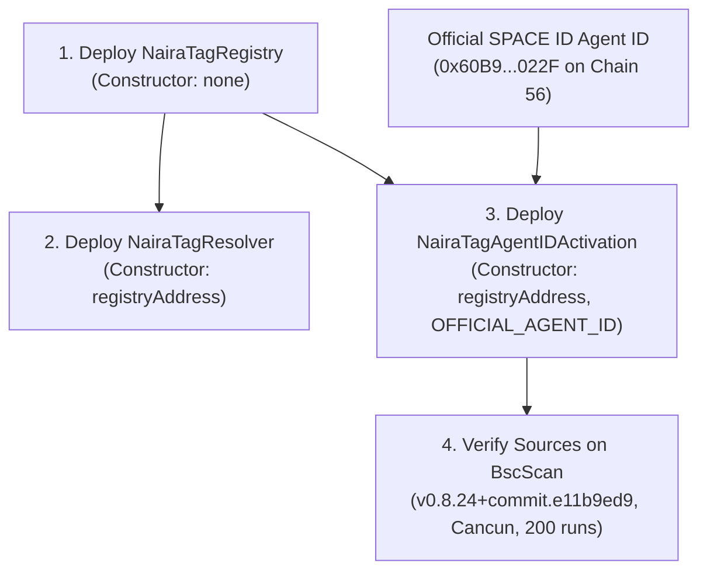

# BNB Smart Chain Mainnet Deployment Guide

## 1. Executive Summary

This guide outlines the production deployment procedure for the **NairaTag Protocol** stack on **BNB Smart Chain Mainnet (Chain ID 56)**.

The deployment establishes sovereign human-readable tags (`₦TAG` / `@name`) directly alongside the official **SPACE ID Agent ID (BEP-721)** contract (`0x60B9262456dE011F7d15a54CdD8c48bAaa8B022F`).

---

## 2. Deployment Architecture & Dependency Sequence

The contracts must be deployed in strict sequential order:



### Deployed Contract Specifications

| Contract | Purpose | Constructor Dependencies | Estimated Gas |
|---|---|---|---|
| **`NairaTagRegistry`** | Canonical sovereign tag namespace (NTS-100 normalization, 1-tag limit) | None (`[]`) | ~1,226,763 |
| **`NairaTagResolver`** | Forward/reverse address resolution, coin types, text metadata | `address registry` | ~1,328,597 |
| **`NairaTagAgentIDActivation`** | On-chain credential activation for official SPACE ID Agent ID holders | `address registry, address agentIdContract` | ~750,000 |
| **Total Gas Estimate** | | | **~3,305,360** |

---

## 3. Defensive Engineering & Safety Guardrails

All deployment and verification scripts enforce the following architectural rules:

1. **Cryptographic Key Derivation & Match Gate**:
   - `preflight-mainnet.cjs` and `deploy-bsc-mainnet.cjs` derive the deployer address from `PRIVATE_KEY` using Viem's `privateKeyToAccount`.
   - The derived address is strictly compared against `DEPLOYER_ADDRESS` in `.env`. Any discrepancy immediately halts execution (`CRITICAL_DEPLOYER_MISMATCH`).
   - Private keys are never printed, logged, or exposed in output.

2. **Network & Chain ID Lock**:
   - Both scripts verify `client.getChainId() === 56`. Connections to testnet or other networks immediately fail (`CHAIN_ID_MISMATCH`).

3. **External Dependency Validation**:
   - The official SPACE ID Agent ID contract (`0x60B9262456dE011F7d15a54CdD8c48bAaa8B022F`) must exist and contain verified bytecode on Mainnet before any deployment can start (`AGENT_ID_BYTECODE_MISSING`).

4. **Strict Receipt & Bytecode Verification**:
   - After each deployment transaction, the receipt status is checked for `status === 'success'`. Reverted transactions throw immediately (`DEPLOYMENT_FAILED`).
   - The returned contract address is inspected on-chain for active bytecode (`BYTECODE_VERIFICATION_FAILED`).

5. **Atomic Incremental Manifest & Resumption**:
   - Progress is written to `deployments/bsc-mainnet.json` after **each** individual contract deployment.
   - If a script is interrupted (e.g., out of gas or network issue), re-running the script automatically detects existing contracts, validates their on-chain bytecode, and resumes without re-deploying or wasting gas.

6. **Compiler Metadata Parity**:
   - All deployments and BscScan verification use the exact Foundry compilation profile:
     - **Solidity Version**: `v0.8.24+commit.e11b9ed9`
     - **EVM Version**: `cancun`
     - **Optimizer**: `enabled: true`, `runs: 200`
     - **License**: `MIT` (`3`)

7. **Explicit Broadcast Safety Lock**:
   - `deploy-bsc-mainnet.cjs` will **never** broadcast unless `CONFIRM_MAINNET_BROADCAST=true` is set.

---

## 4. Preflight & Execution Workflow

### Step 1: Run Preflight Check

```bash
node script/preflight-mainnet.cjs
```

The preflight script verifies `.env`, derives the account, queries the live Mainnet gas price and deployer balance, and calculates the required gas budget and recommended buffer.

### Step 2: Fund Deployer Account

Ensure the verified deployer address holds sufficient BNB:
- **Estimated Cost**: `~0.003 - 0.004 BNB` (at 1–2 Gwei)
- **Recommended Buffer**: `0.005 - 0.010 BNB`

### Step 3: Execute Deployment

When authorized by the project lead:

```bash
CONFIRM_MAINNET_BROADCAST=true node script/deploy-bsc-mainnet.cjs
```

### Step 4: Verify Source Code on BscScan

```bash
node script/verify-mainnet-contracts.cjs
```

All three contracts will be submitted to BscScan via the Etherscan V2 API and polled until public verification is confirmed.
